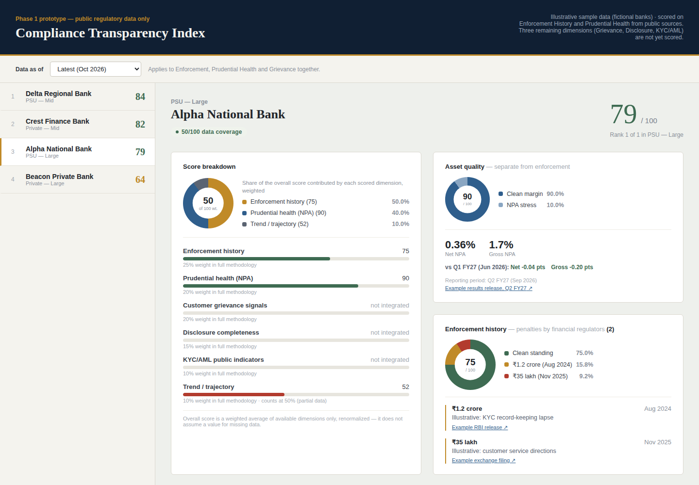
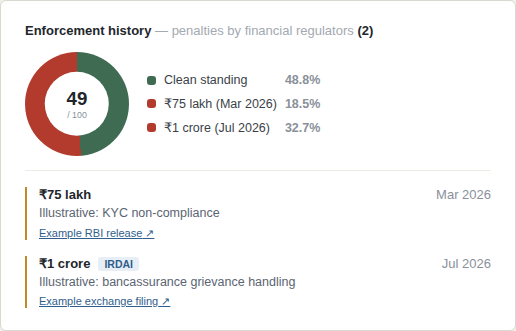
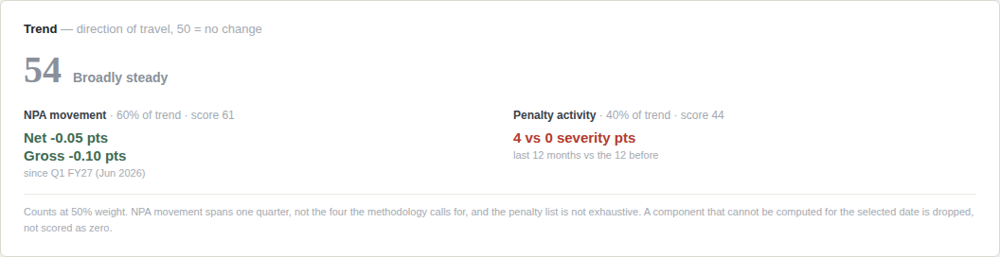
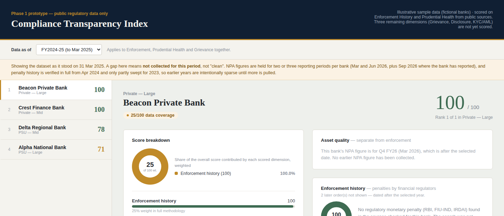

# Compliance Transparency Index

A prototype that puts the public compliance record of Indian banks in one place: regulatory penalties, asset quality and trend, scored transparently and comparable over time. Every figure links to the filing it came from, and missing data is shown as a gap, never as a zero.

> **Prototype, not a rating.** Built on public data only, with a penalty list that is not exhaustive. It is not endorsed by any bank or regulator, is not legal or financial advice, and a score here says nothing definitive about any bank's compliance. See [Limitations](#limitations).



*Screenshots show the fictional sample dataset.*

## Why this exists

Banks run compliance tools, and regulators receive returns on schedule. What is hard to see from outside is the difference between a bank that runs compliance as a continuous discipline and one that treats it as a periodic reporting exercise, and there is no single view where a bank's record can be compared with its peers and tracked over time.

This project is a first step towards that view. It deliberately starts with what public data can show, which is outcomes: penalties, asset quality and how both are moving. It **cannot yet see how banks use their compliance tools**, because that data sits inside the banks. [docs/ROADMAP.md](docs/ROADMAP.md) describes how that could change.

## What it does

- **Scores banks on three dimensions today:** Enforcement History, Prudential Health (net NPA) and Trend. Three more (Customer Grievance, Disclosure Completeness, KYC/AML indicators) are designed and shown as "not integrated".
- **Never invents data.** A dimension without data is left out of the average and lowers a visible *data coverage* figure.
- **Links every figure to its source:** RBI releases, NSE/BSE filings, bank filings, other regulators' orders.
- **Has a "Data as of" filter** that re-renders every dimension as it would have looked at an earlier date.
- **Includes penalties from other financial regulators** (FIU-IND, IRDAI) alongside RBI's, tagged by regulator.
- **Has tests** for the scoring maths and for the shape and sourcing of the dataset.

| | |
|---|---|
|  |  |
|  | |

## Quick start

Requires Node.js 20.19 or newer.

```bash
npm install
npm run dev        # http://localhost:5173
npm test           # scoring maths + dataset checks
npm run build      # production build in dist/
```

`npm install` creates a `package-lock.json`; commit it.

## Choosing what to publish

This repository ships two datasets:

| File | Contents |
|---|---|
| `src/data/banks.js` | The compiled dataset: 20 named Indian banks, with sourced penalties and NPA figures. |
| `src/data/banks.sample.js` | Four fictional banks. Also the reference for the data format. |

The compiled dataset is built from public records, but it names real institutions and produces a ranked list, so decide deliberately what you put in front of the public.

- **Publish the compiled dataset.** Most useful for review and discussion. Anyone can read the data file and see the demo's scores.
- **Publish sample data only.** Replace the compiled dataset before your first commit:

  ```bash
  cp src/data/banks.sample.js src/data/banks.js
  UPDATE_GOLDEN=1 npm test    # regenerate the score snapshot for the sample data
  ```

  Git keeps history, so make this choice before the first push.

For the demo site, `.github/workflows/deploy.yml` is manual and defaults to the sample dataset (`VITE_DATASET=sample`). That setting changes what the UI shows. The compiled data can still be inside the JavaScript bundle, so for a demo that contains no real data at all, use the second option above.

## How scoring works

Each dimension is scored 0 to 100 and combined into a weighted average. Full detail, with every formula and threshold, is in [docs/METHODOLOGY.md](docs/METHODOLOGY.md); all values live in [`src/lib/config.js`](src/lib/config.js).

| Dimension | Weight | Status |
|---|---|---|
| Enforcement History | 25% | Scored: penalties by severity, decaying to zero over 48 months |
| Prudential Health | 20% | Scored: net NPA |
| Customer Grievance Signals | 20% | Shown for one bank, not scored |
| Disclosure Completeness | 15% | Not integrated |
| KYC/AML public indicators | 10% | Not integrated |
| Trend | 10% | Scored, counts at half weight |

The overall score uses only dimensions that have data, each counted at weight × coverage. The *data coverage* figure (out of 100) says how much of the intended methodology actually backs a score.

## Data

The compiled dataset covers 20 banks (10 public sector, 10 private) with:

- **74 penalty records** (70 RBI, 3 FIU-IND, 1 IRDAI) and 47 distinct source links. Two entries are still marked "source link pending verification".
- **NPA for two or three quarters per bank** (Mar 2026, Jun 2026, and Sep 2026 for all 20 banks, as of 27 November 2026), each with a source link.
- **One bank's complaint disclosure** (grievance), shown but not scored.

Where the data comes from, how it is recorded, how complete it is, and how to add to it: [docs/DATA_SOURCES.md](docs/DATA_SOURCES.md).

## Project structure

```
src/
  data/       banks.js (compiled dataset), banks.sample.js (fictional), index.js (chooses one)
  lib/        config.js (all methodology values), scoring.js (pure scoring engine), charts.js
  components/ DonutChart, Legend, DimBar, TrendCard, GrievanceCard, SourceLink, ...
  App.jsx     layout, the "Data as of" filter, bank list and detail view
tests/        scoring maths, dataset integrity, golden score snapshot
docs/         methodology, data sources, roadmap, proposed ingestion schema
.github/      CI (tests + build) and a manual GitHub Pages deploy
```

## Limitations

- **Penalty coverage is incomplete.** It is verified in full only from April 2024; April 2023 to March 2024 is partly covered and earlier years are not covered. A bank showing no penalty means none was found in the sources checked.
- **Other regulators are thinly covered.** SEBI orders and stock-exchange fines have not been searched, and FIU-IND and IRDAI orders are partial. Tax assessments and penalties on subsidiaries or insurers are excluded.
- **Severity is capped at ₹1 crore and above.** A ₹12 crore penalty scores the same as a ₹1 crore one.
- **Trend is short.** It compares one quarter of NPA movement, not four, and uses a 12-versus-12-month window for penalties, so a penalty can drop out of the comparison abruptly.
- **Scores are absolute.** Banks are ranked within their peer cohort, but scores are not normalised by cohort.
- **Weights and thresholds are public.** Anyone can see exactly what moves a score.
- **Complaint counts are not comparable across banks yet.** Banks define and count complaints differently.

## Reporting a correction

Every figure should link to its source, so the most useful correction is a better source. Open an issue with the bank, the figure, and the link. See [docs/DATA_SOURCES.md](docs/DATA_SOURCES.md) for how records are structured.

## Ownership and licence

Copyright (c) 2026 Prathmesh Koyande. All rights reserved. The source is published for review and discussion; no licence to copy, modify or redistribute is granted yet. To open it up, add a `LICENSE` file (for example MIT, or a non-commercial licence if you want to restrict commercial use).

## Author

Prathmesh Koyande · `<LinkedIn URL>`

Comments, critique and corrections from people in banking compliance, regtech and supervision are welcome.
